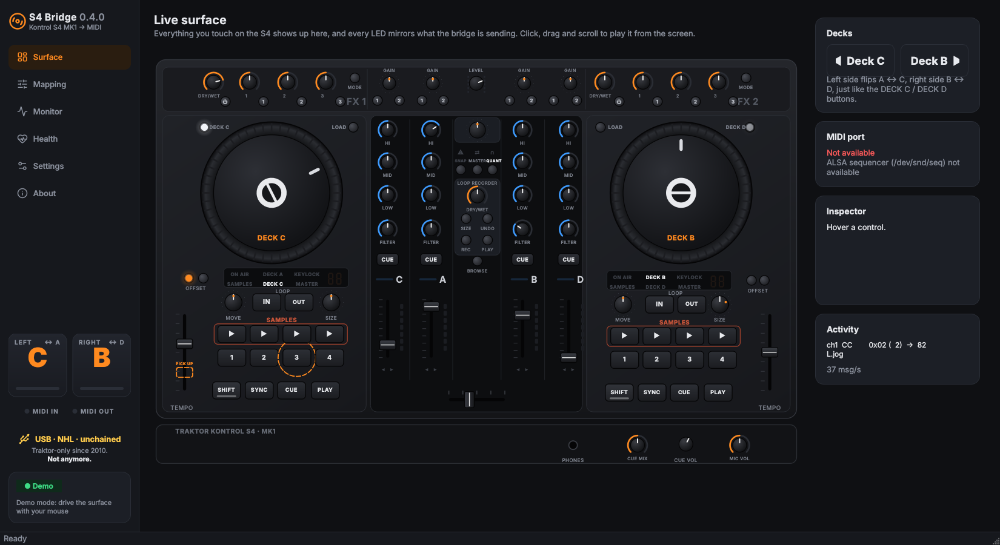
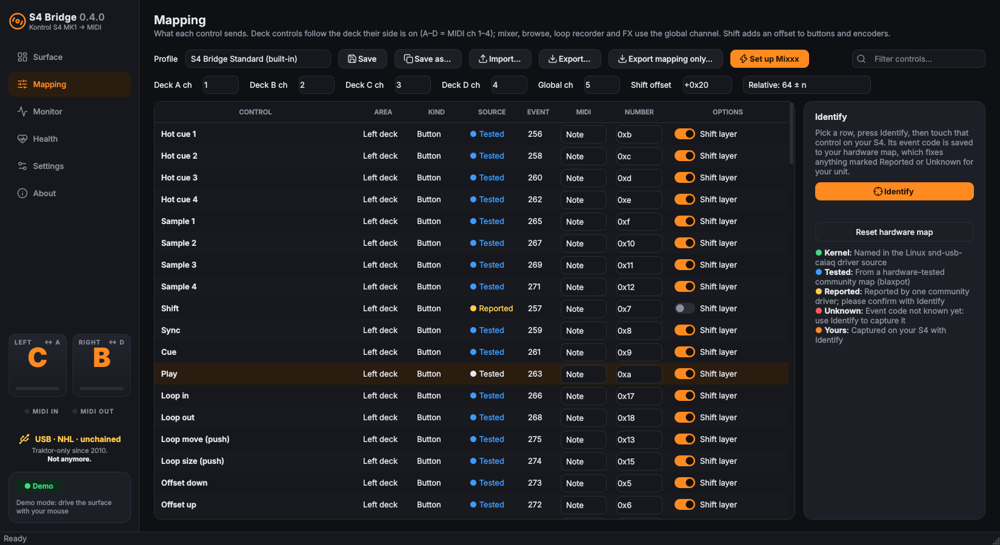

# S4 Bridge

Use the **original (MK1) Native Instruments Traktor Kontrol S4** with Mixxx, a DAW, or anything else that speaks MIDI on Linux. You also get full LED feedback.

The MK1 isn't a MIDI device. It talks NI's own USB protocol, and only Traktor ever understood it. The Linux kernel's `snd-usb-caiaq` driver already exposes the S4's audio card, every knob and button (as input events), and every LED (as ALSA controls). S4 Bridge sits on top of that and does the rest:

- **One virtual MIDI port** ("S4 Bridge › Kontrol S4 MK1"), in and out, visible to ALSA, PipeWire and JACK apps.
- **Four decks.** DECK C / DECK D flip each side between A↔C and B↔D, on MIDI channels 1–4. The bridge remembers each deck's LEDs, so flipping sides repaints the pads instantly.
- **Shift layers** for deck buttons, encoders and jogs, plus a global shift for the centre and FX sections.
- **Jog wheels** with wrap-safe relative output, capacitive touch with hysteresis, and adjustable scaling.
- **Soft takeover on the tempo faders.** After a deck flip, the fader does nothing until it reaches the new deck's tempo. OFFSET ▲/▼ light to show which way to push, and the surface shows a ghost marker. It works in any app that sends the tempo back.
- **14-bit tempo faders.** The S4's pots are 12-bit, so 7-bit MIDI would waste most of the resolution.
- **LED feedback:** two-colour hot cues, VU meters with clip, the two 7-segment displays, deck/on-air/keylock/master lamps, and FX and mixer buttons.
- **Live surface view.** A drawing of the S4 that moves and lights exactly like the real one. It's also a virtual controller you can click, drag and scroll.
- **Mapping editor** with per-control note/CC, number, shift, 14-bit and invert, saved as JSON profiles.
- **Identify** captures a control's event code from your own unit, which fixes anything the community maps got wrong.
- **One-click Mixxx export** writes a Mixxx 2.4+ mapping (XML + script) that matches your current profile.
- **Stays out of your way.** No pop-ups when things work, and the Mixxx mapping updates itself.
- **Lives in the tray.** It can start quietly at login, and the icon turns amber when the S4 is connected. Closing the window keeps it running; right-click the icon for Set up Mixxx, Health check, Test LEDs and Quit.
- **Health check** tests every link from the S4 to your speakers in order (kernel driver, permissions, controls, MIDI port, LEDs, the S4's PipeWire outputs, and Mixxx's mapping, controller and audio routing). It says in plain words what's wrong, with a one-click fix where possible.
- **Headless mode** runs as a systemd user service.

Licensed GPL-3.0-or-later. © 2026 Fancy Butler.





---

## Install

### Check the kernel side first

Plug the S4 in and switch it on, then run:

```fish
cat /proc/asound/cards | grep -i kontrol        # → [TraktorKontrolS]: snd-usb-caiaq - Traktor Kontrol S4
grep -A4 'Kontrol S4' /proc/bus/input/devices    # → an input device with an eventN handler
```

If the second check shows nothing, your kernel was built without `CONFIG_SND_USB_CAIAQ_INPUT`. Arch/CachyOS, Fedora and Ubuntu kernels all ship with it on.

### Arch / CachyOS

```fish
cd packaging/arch
makepkg -si
sudo udevadm control --reload; and sudo udevadm trigger
```

### Fedora

```fish
sudo dnf install python3-pyside6 python3-evdev alsa-lib
pipx install --system-site-packages .
sudo install -m644 packaging/70-s4bridge.rules /etc/udev/rules.d/
sudo udevadm control --reload; and sudo udevadm trigger
```

### Debian / Ubuntu (24.04+)

```bash
sudo apt install python3-pyside6.qtwidgets python3-pyside6.qtsvg python3-evdev pipx
pipx install --system-site-packages .
sudo install -m644 packaging/70-s4bridge.rules /etc/udev/rules.d/
sudo udevadm control --reload && sudo udevadm trigger
```

The udev rule gives the logged-in user access to the S4's input device and stops it showing up as a joystick. Unplug and replug once after installing it.

There are no compiled Python extensions. MIDI and LEDs go straight to `libasound` through ctypes.

---

## Use

Turn on **Settings › App › Start S4 Bridge when I log in** and it's simply there whenever the S4 is.

```
s4bridge            # the app (a second launch just brings the running one forward)
s4bridge --minimized # start in the tray
s4bridge --demo     # no hardware: play a simulated S4 with your mouse
s4bridge --headless # background only, no GUI (or: systemctl --user enable --now s4bridge)
s4bridge --setup-mixxx # one-click Mixxx setup from the terminal
```

Only run one at a time: the bridge takes exclusive access to the controller.

### Mixxx

1. Quit Mixxx, start S4 Bridge with the S4 switched on.
2. Click **Mapping › Set up Mixxx** (or run `s4bridge --setup-mixxx`). One click installs the mapping, enables the controller, and sends Mixxx's Main and Headphones to the S4's own outputs. Your old Mixxx settings are backed up as `*.s4bridge-backup`.
3. Start Mixxx and play.

After that, S4 Bridge keeps Mixxx's copy of the mapping current by itself (whenever Mixxx is closed) after updates or profile edits. It never touches your Mixxx sound settings unless you click Set up Mixxx.

The mapping covers:

**Lights:** PLAY pulses on the beat and flashes in the last seconds of a track (Mixxx's end-of-track warning), hot cues show their Mixxx colour (green, blue, or both for warm colours), and the deck display shows loop size, time left (minutes get a dot after 99 s) or Camelot key (dot = B/major).


| Control | Normal | With Shift |
|---|---|---|
| Play | play/pause | keylock |
| Cue | Traktor-style: paused = set cue exactly here (ignores quantize), hold to preview, PLAY while holding keeps it going; playing = back to cue and stop | jump to start |
| Sync | sync | sync leader |
| Pads 1–4 | hot cues 1–4: empty pad sets a cue, set pad jumps to it (blue = set, green = playing from it) | clear |
| ▶ sample row | **pad modes** (SHIFT + push MOVE cycles; the SAMPLES lamp shows the mode): **Samples**, 4 slots per side (left = Mixxx samplers 1–4, right = 5–8); **Stems** (Mixxx 2.6+), tap to mute drums/bass/other/vocals, hold a pad + turn MOVE for that stem's volume; **Rolls**, hold for a 1/8, 1/4, 1/2 or 1-beat loop roll | samples: stop/eject; stems: that stem's quick effect |
| Loop in/out | loop in/out at the exact cursor position (beat-snapped when SNAP is lit) | reloop / reloop & stop |
| Loop move knob | beat jump (push = reloop) | fine tempo; push = next pad mode |
| Loop size knob | halve/double (push = auto loop of that size, starting exactly at the cursor unless SNAP is lit) | beat-jump size; push = next display mode (loop size → time left → Camelot key) |
| Offset ▲▼ | temporary nudge | ▲ reset tempo; ▼ **FLUX** (slip mode: scratch/loop/roll and the track keeps running underneath) |
| Jog | stopped: moves the track like a platter; playing: edge nudges, touching the top scratches | fast search (or scrolls the list in Browse view) |
| Load | load selected track | eject |
| Gain encoder | pre-gain (push = reset) | filter |
| Channel CUE | headphone cue | **Mixer FX**: steps the FILTER knob's quick effect (filter → other one-knob effects) |
| Mixer FX 1/2 | assign to FX unit 1/2 | units 3/4 |
| FX units | mix, 3 meta knobs, on, 3 effect toggles, MODE = next chain | buttons = next effect |
| Browse | scroll (push = open item) | move focus |
| BROWSE button | big library; jogs scroll the track list while it's open (Load buttons load) | jogs page 8 rows at a time |
| Quant | quantize on all decks | |
| Snap | cue and loop points snap to the beat grid (off by default: they land exactly where you leave the cursor) | |
| Loop recorder REC | Mixxx recording | |

### Other software

Anything that does MIDI learn can use the port directly. The standard profile is:

- **Decks A–D → MIDI ch 1–4**, global/FX → **ch 5**
- Deck buttons are notes and shift adds `0x20`. Global buttons are notes and shift adds `0x40`.
- Pots are CCs. Tempo faders are 14-bit (MSB `0x04`, LSB `0x24`).
- Jogs and encoders are relative CCs (64 ± n, or two's complement).

**LED feedback in.** Send back the same note on the same channel. Velocity sets brightness. Hot cues use velocity for colour: 1–42 blue, 43–85 green, 86+ both. LED-only addresses on each deck channel:

| What | Message |
|---|---|
| On air | note `0x60` |
| Samples | note `0x61` |
| Keylock | note `0x62` |
| Master | note `0x63` |
| Display | CC `0x50` (0–99 shown, 100 blank, 101 `--`) |
| VU meter | CC `0x46` (0–126, 127 = clip) |
| Crossfader ◂ / ▸ | notes `0x47` / `0x48` |
| Tempo position (for soft takeover) | CC `0x51` (0–127) |
| Channel bar | note `0x49` |

Global lamps (Quant, Headphone, Master, Snap, Warning) are notes `0x70`–`0x74` on ch 5. The **Mapping** page shows everything else.

---

## What's confirmed and what isn't

Every control in the app is tagged with where its event code came from:

- **Kernel** comes from the `snd-usb-caiaq` driver source. These are the fader/knob axes, jogs, touch sensors and all LED names, so they're solid.
- **Tested** comes from blaxpot's hardware-tested `traktor-s4-mk1-midify` map. That covers nearly every button and encoder.
- **Reported** is only in one other project (jmanera): the Shift buttons, DECK C/D toggles, Snap/Master/Quant, and Gain A push.
- **Unknown** means the button exists but its code hasn't been published: Gain push on B, C and D.

To fix or fill any of these, go to **Mapping**, select the row, click **Identify**, and touch the control. That writes to `~/.config/s4bridge/hardware.json` and overrides the built-in map.

Things to check on first contact with real hardware:

1. **Shift, DECK C/D, Snap/Master/Quant.** If one does nothing, Identify it.
2. **FX knob order.** The kernel comments and the tested map disagree about which way round dry/wet and knobs 1–3 are numbered. The app follows the tested map. Turn each FX knob and watch the surface.
3. **Jog ticks per turn.** Default is 1000, measured on a real S4 MK1. To fine-tune: **Settings › Jog wheels**, reset, spin one full turn, click **Use measured**. Applies live.
4. **Tempo fader direction.** If up is slower, tick **Invert** on the Tempo rows.
5. **Display digits.** If loop sizes read backwards (e.g. "61" for 16), tick **Swap the two display digits**.

## Credits

- Daniel Mack: the `snd-usb-caiaq` kernel driver.
- Conal Moloney (blaxpot): `traktor-s4-mk1-midify` control map (MIT).
- Javier Manera: `traktor-kontrol-s4-mk1-driver-linux`.
- Lucide icons (ISC).

Not affiliated with Native Instruments. Traktor and Kontrol are trademarks of their owner.
